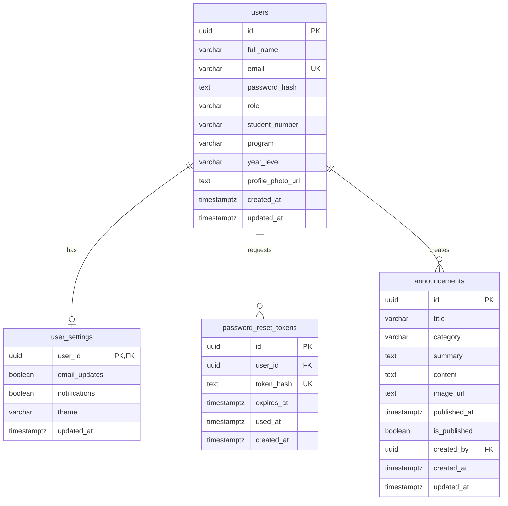

# Entity-Relationship Diagram (implemented database)

## Notes
- Roles: `student`, `faculty`, `admin`.
- Announcements are stored in PostgreSQL (no longer mock arrays).
- College profile, module catalog, and featured cards remain static configuration data suitable for a CMS config table in a later iteration.
